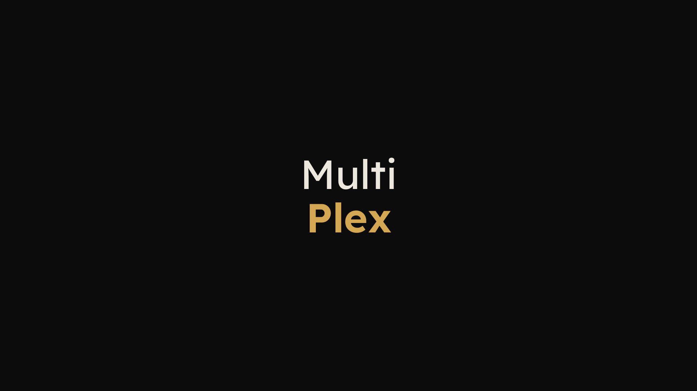
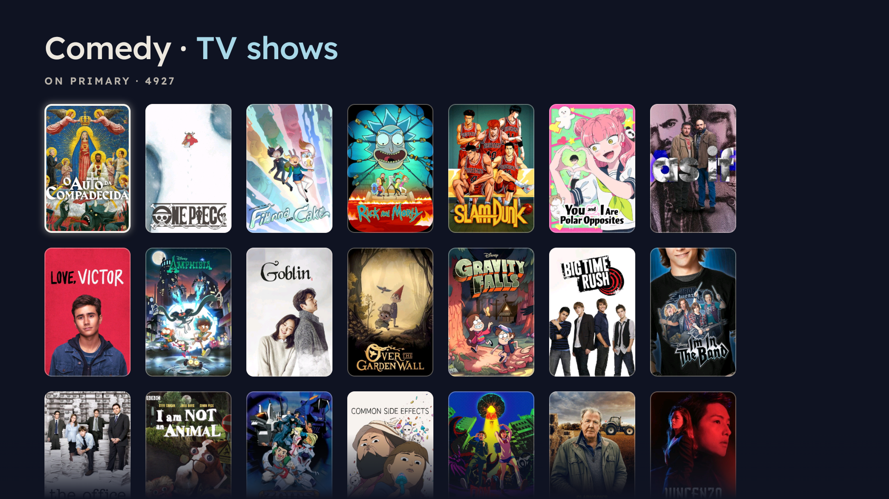

# MultiPlex for Google TV

Releases of the MultiPlex TV app for one family's TVs. There is no code here.

MultiPlex works only for people the family has invited: you sign in with your own Plex account.

## Install MultiPlex on your TV (once, about 5 minutes)

You need the TV's remote and a phone.

### 1. Install Downloader

On the TV, open the **Google Play Store**, search for **Downloader** (by AFTVnews) and install it. It's free.

### 2. Let Downloader install apps

Android only installs apps from the Play Store until you allow another app to do it.

1. On the TV, open **Settings › Apps › Security & restrictions › Unknown sources**.
2. Turn on **Downloader**.

On some TVs the menu is called **Install unknown apps** instead. If you can't find it, open Downloader once; it shows you the way when it needs the permission.

### 3. Download MultiPlex

1. Open **Downloader**.
2. In the box on its Home screen, type this address and press **Go**:

   **`multiplex.whitside.com/get`**

Downloader fetches the newest MultiPlex from this page's releases.

### 4. Install

When the download finishes, Android asks whether to install MultiPlex. Choose **Install**, then **Done**.

Downloader then offers to delete the downloaded file. Choose **Delete**: MultiPlex is installed and the file isn't needed any more.

If MultiPlex was already on the TV from an earlier test version, Android may say the app isn't compatible. Uninstall the old one first (Settings › Apps › MultiPlex › Uninstall), then install again.

### 5. Open MultiPlex

MultiPlex is now with your other apps (on Google TV: **Apps**, or **Your apps** at the end of the first row). Open it.

### 6. Sign in with your phone

MultiPlex shows a QR code.

1. Scan the code with your phone's camera.
2. Sign in to Plex on your phone if it asks, then tap **Allow** on the Plex page that opens.
3. The TV signs in by itself.

No phone handy? On any computer or phone, go to **plex.tv/link** and type the short code shown under the QR code.

That's it. MultiPlex opens on Home, with what your household is watching. Search finds any title or genre:

## Updates

You don't need Downloader again. When there's a new version, MultiPlex shows **Update available** when it starts (at most once a day) with what's new. Choose **Update**.

- The first time, Android asks you to let MultiPlex install its updates: turn on MultiPlex on the screen it opens, then press **Back**.
- Android then asks you to confirm the install. MultiPlex closes while it updates; open it again from your apps.
- MultiPlex installs only updates signed with its own key whose checksum matches the release, and never while something is playing.
- To check any time: **Settings › Troubleshooting › Check for updates**.

## Checking a download (optional)

Each release lists a SHA-256 checksum for each file in **SHA256SUMS.txt**. The update inside the app checks this for you. To check a file you downloaded on a computer:

- **Windows** (PowerShell): `Get-FileHash MultiPlex-arm32.apk -Algorithm SHA256`
- **Mac / Linux**: `shasum -a 256 MultiPlex-arm32.apk`

The result must match the line for that file in SHA256SUMS.txt.

## Which file?

- **MultiPlex-arm32.apk**: Google TV Streamer and most TVs. The short link gives you this one.
- **MultiPlex-arm64.apk**: TVs and boxes running 64-bit Android, if you were told to use it.
